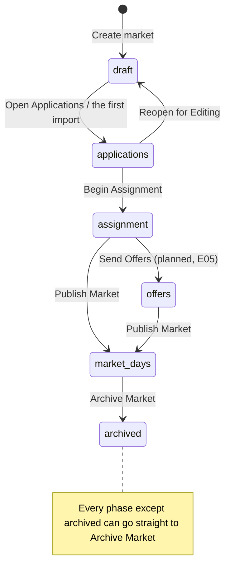

# The market lifecycle at a glance

**Who:** the organizer, as the market's Admin or owner; anyone below Admin sees where the market stands and is offered no move ([what each role may do](../rules/what-each-role-may-do.md)).
**Where:** the phase rail, under the market bar on every market screen.
**Serves:** [The market's phase says what to do next](../intents/the-markets-phase-says-what-to-do-next.md).

A market is always in exactly one phase, and the phases are the same on both intake paths: Draft, one stage where applications arrive and are reviewed at once, Assignment, Market Days, Archived.
The stage is stored as `applications` and named by the path ([ADR 0016](../../adr/0016-one-stage-for-applications-and-review.md)): a market whose vendors apply on its own page (the online path) reads Draft, Applications, Assignment, Market Days, Archived; a market whose vendors apply on the organizer's own Google Form (the Google Form path) reads Draft, Review, Assignment, Market Days, Archived.
The online path enters the stage by opening applications; the Google Form path by its first import, confirmed and written, which takes the move itself.

The rail offers the one next step as its main button, and every other move behind "More…".
A move the server would refuse is drawn disabled before the click, with its first blocker as the rail's sentence and beside the move in the menu.
When that blocker names a page that fixes it, the main button becomes the fix ("Add a location") and leads there, with the move beside it as the step after.
A move that loses a race with another change still answers with a red "Cannot proceed:" panel under the rail.
Every move lands on the page where the new phase's work is done, forward or back.
Every rule about moving a market lives with [the guards](../../implementation/modules/guards.md); how the rail draws it is [the phase rail](../../implementation/modules/phase-rail.md).

**Status:** Works (read from the code and specs as of E38/F04: `back-end/guards.py`, `front-end/src/utils/marketGuide.ts`; `phase-rail.spec.ts`, `every-move-lands.spec.ts`, `a-blocked-step-offers-its-fix.spec.ts`, `what-to-show-and-when.spec.ts`, `market-journey.spec.ts`).

On the Google Form path the move into Review waits on an import, so the rail's main button in Draft is the fix "Import responses", with "Begin Review" disabled beside it; the import takes the move once its rows are written ([review needs an import](../rules/review-needs-an-import.md)).
Inside the stage, More… also offers what is not a move: "Redo import" on the Google Form path, and "Stop taking applications" or "Take applications again" on the online path ([taking applications](taking-applications.md)).

## The phases

| Phase (online path / Google Form path) | What happens here | Page it opens on | Forward step | More… |
| --- | --- | --- | --- | --- |
| Draft / Draft | Plan the market, build the form | Market Setup | Open Applications / Import responses (the fix), then Begin Review | Archive Market |
| Applications / Review | Online applications arrive and are reviewed as they do / every imported response is reviewed | Applications | Begin Assignment | Stop taking applications or Take applications again / Redo import; Reopen for Editing, Archive Market |
| Assignment / Assignment | Set the rules, run, adjust by hand; on the online path, publish results | Assignment, then Result once run | Publish Market | Archive Market |
| Offers (planned) | Vendors accept or refuse | Result once run, else Assignment | Publish Market | Archive Market |
| Market Days / Market Days | Vendors check in | Attendance | Archive Market, once every date has passed | Archive Market, until then |
| Archived / Archived | Read only | Result if it was assigned, else Market Setup | none | none |

"Send Offers" is never offered: Offers is a planned phase off the rail, which draws it only for a market actually in it.

## What the rail says

One sentence per phase and path names the one next step and links to the page where it is done ([the market guide](../../implementation/modules/market-guide.md)).
When the server would refuse that step, the sentence is its first blocker instead, so the organizer reads what is wrong before trying.

| Phase | Online path | Google Form path |
| --- | --- | --- |
| Draft | "Plan the market and its application form, then open applications." | "To begin review: Nothing has been imported yet. Import your Google Form's responses first.", once the plan is complete |
| Applications / Review | "Applications are open on your application page: review them as they arrive. Every application is decided: begin assignment.", or, stopped, "Your application page is not taking applications. …" | "Every imported response is here. Every application is decided: begin assignment." |
| Assignment, nothing run | "Set the rules and run the assignment." | as the online path |
| Assignment, run | "Check the result, then publish the market: that puts the check-in page up, and cannot be undone." | as the online path |
| Assignment, results published | "Results are published, so the result is settled. Publish the market to put the check-in page up; that cannot be undone." | none: nothing is published to applicants |
| Market Days | "Check vendors in at the door.", and once every date has passed "The market has run. Archive it to keep it as the record of what happened." | as the online path |
| Archived | "Archived: the record of what happened stays on its check-in page." for a market that ran, else "Archived: this market is the record of what happened." | as the online path |

Every tab stays on the bar from Draft to the end, on both paths.
A tab whose page has no work yet says when it will: Applications in Draft ("Applications arrive here once they open.", or on the Google Form path "Responses arrive here with your first import, which begins review."), and Attendance until the market is published ("Opens when the market is published.").
The note stands in for the tab's pages only, never for a flow it holds, so the first import opens from Draft.
Result and Vendors say "Nothing assigned yet." until a run is stored ([the assignment and its result](assignment-and-result.md)).
The setup, the form and the assignment rules each say they are settled where they are edited, in the server's own words.

## What refuses a move

Each refusal is a blocker line under the rail and beside the move, before the click.

| Move | Refused when | It says |
| --- | --- | --- |
| Leaving Draft (Open Applications, the first import) | The plan has no dates, or a date has passed | "This market has no market dates. Pick them on Market Setup's calendar." / "N of this market's dates have already passed: …" |
| Leaving Draft | The plan has no location | "This market has no location. Add one on Market Setup." |
| Leaving Draft | The plan has no tables, or a tier has none | "This market has no tables yet. Add a section with tables on Market Setup." / "Tier X has no tables. …" |
| Leaving Draft | The form asks nothing: no custom field, and the plan offers no dates, no tiers and fewer than 2 sections | "The application form asks nothing. …" |
| Leaving Draft, on the Google Form path | Nothing has been imported: the first import, written, is the way in | "Nothing has been imported yet. Import your Google Form's responses first." |
| The stage → Draft | Any application exists, imported or applied | "N applications are already in, so this market cannot return to draft. …" |
| The stage → Assignment | Any application still Open, Under review or needing a follow-up; or none at all | "N applications are still awaiting review…" / "N applications need a follow-up…" / "There are no applications for this market. …" |
| The stage → Assignment | An approved applicant named a tier that has no tables | Names the tier and the applicants |
| The stage → Assignment, and into Market Days | A hand placement names a seat the plan no longer has | Names the vendor, table and date |
| Assignment → Offers | Any application is still Approved (always true today: M1) | "N applications are still approved but not yet assigned or unassigned. …" |
| Into Market Days | No assignment is stored | "No assignment has been computed for this market, so its check-in page could not tell anyone where to stand. Run the assignment first." |
| Into Market Days, on the online path | Results are not published | "Applicants have not been told whether they have a table. Publish the results before the market goes live." |

Moves that cannot be undone (Publish Market, Archive Market) open a confirmation dialog focused on Cancel.
Every other move fires on one click.

## Where the check-in address lives

Once a market is published, the rail carries its check-in page's address as a chip between the spine and the moves, with Copy; it is the one place the product tells the organizer the address vendors check in at.
The chip stays on an archived market that ran, whose page stays up as its record ([an archived market that ran stays a record](../rules/an-archived-market-that-ran-stays-a-record.md)); before publishing there is none, since it would lead to a page that does not exist yet.
A form market's application page has a chip of its own on the same row, from the first phase after Draft ([a gated market answers as absent](../rules/a-gated-market-answers-as-absent.md)).

The spine, the addresses and the moves share one row at the organizer's screen width; where the row cannot hold them, the addresses and the moves take a second row together ([the phase rail](../../implementation/modules/phase-rail.md)).
A market that leaves the spine freezes it at the furthest phase it reached and says in words what became of it, such as "It was published and ran its market days.": a struck-through spine alone reads as stopped, not as archived.

## Why the phases are the order of the work

The phases are the order in which a market is built and run, and the rail reads that order from the phase machine rather than from a list of its own ([the phase rail](../../implementation/modules/phase-rail.md)).
The screens follow the phase rather than standing beside it as peers: a move lands on its phase's page, the bar's dot marks the tab the market is worked on now, and a tab out of its phase says when it will matter.
The market's state is the phase alone; a tab is a place to look, never a state.

`draft` holds two stages, in order: the plan, then the form built from it.
The form's essential questions offer exactly what the plan holds, so the form has nothing to ask until the plan does; no phase sits between the two, because both are the organizer's own work before anyone applies, and Market Setup shows the order instead ([planning the market](planning.md)).
The assignment rules (priority and options) and Assign belong to the Assignment tab, not to Market Setup: a priority rule names a question of the form, so it cannot be written before the form exists, and Assign runs only in `assignment` ([assign runs only in assignment](../rules/assign-runs-only-in-assignment.md)).

## Superseded

- Every earlier stage was to stay editable in later phases, the plan included (wayfinding/the-order-of-the-work/01); the setup settles on leaving draft instead ([the setup settles on leaving draft](../rules/the-setup-settles-on-leaving-draft.md), E31/F01).
- The Google Form path was to say "Start Collecting" and "Done Collecting" and stop in Applications Open and Applications Closed, with Import still open in both (wayfinding/what-to-show-and-when/02); it then stopped in Import, left Draft with "Import responses" and stepped through Applications Closed into Review (E32/F02/S01).
- Applications Open, Applications Closed and Review were three phases, with Close Applications, Begin Review, Reopen Applications and Import more responses between them; they are one stage, closing applications is a fact about the form, and a late export is a Redo import (E38/F04, [ADR 0016](../../adr/0016-one-stage-for-applications-and-review.md)).
- Every tab out of its phase was to carry a read-only line of its own, such as "Fixed when applications opened" on Market Setup and "Decided; the assignment works from these" on Applications (wayfinding/what-to-show-and-when/02); the phase alone gives a line only to Applications and Attendance, and the locks the server owns say so where they apply.

## The rules it obeys

- [The setup settles on leaving draft](../rules/the-setup-settles-on-leaving-draft.md): the three blockers on leaving Draft.
- [The form locks at the first application](../rules/the-form-locks-at-the-first-application.md): the way back to Draft closes at the first application.
- [Intake mode decides how vendors arrive](../rules/intake-mode-decides-how-vendors-arrive.md): which path, and so which names and moves.
- [Verdicts settle on entering assignment](../rules/verdicts-settle-on-entering-assignment.md).
- [Publish Results waits for the allocation](../rules/publish-results-waits-for-the-allocation.md): the last blocker into Market Days.
- [An archived market is read-only](../rules/an-archived-market-is-read-only.md), and [an archived market that ran stays a record](../rules/an-archived-market-that-ran-stays-a-record.md).

The paths that walk this lifecycle are [the Google Form path](the-google-form-path.md), [the online path](the-online-path.md) and [the mixed path](the-mixed-path.md); how each flow is walked in a test is in [walking the flows](../../implementation/testing/walking-the-flows.md).
